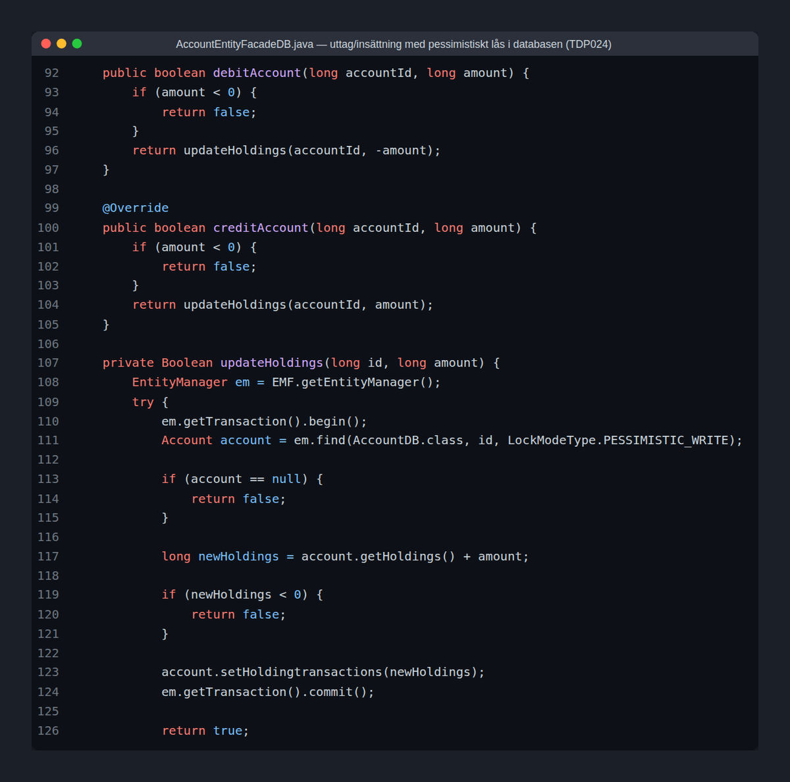
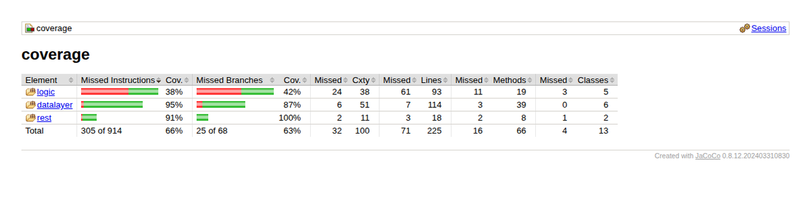

# Banking system (SOA)

A small service-oriented banking system, built in a team of 2. The main part is an account service in Java with Spring Boot, which talks to a person service and a bank service over HTTP.



## Services

- `SOA/account-project/` – the account service (Java 21, Spring Boot, Maven multi-module). Create accounts, deposit and withdraw money, and list all transactions. Split into `account-rest`, `account-logic` and `account-datalayer` (JPA with an embedded Derby database). Concurrent withdrawals are handled with pessimistic locks, and there is a concurrency test for it. `account-xfinal-test` holds the course's acceptance tests, and `account-coverage` aggregates JaCoCo coverage.
- `SOA/Person-service/` – person lookup in Python with FastAPI (port 8060).
- `SOA/Bank-service/` – bank lookup in Go (port 8070).

All three services publish a message per request to Kafka (topic `rest-requests`).

The names and keys in the person and bank services are mock data from the course, not real people or credentials.



## Tech stack

Java 21, Spring Boot, JPA, Apache Derby, Maven, JUnit, JaCoCo, Python (FastAPI), Go, Kafka, REST.

## Running it

Start the two helper services first:

```bash
cd SOA/Person-service
python3 -m venv venv && ./venv/bin/pip install -r requirements.txt
./venv/bin/python person.py

cd SOA/Bank-service
go run bank.go
```

Optionally start Kafka on `localhost:9092`. Then build and run the account service:

```bash
cd SOA/account-project
mvn install -DskipTests
cd account-rest
mvn spring-boot:run
```

The API is served under http://localhost:8080/account-rest/. Run the tests with `mvn verify` from `SOA/account-project` while the services are running.

Built as a course project at Linköping University (TDP024).

More of my projects: https://tdp003-2024-taiku983.kubernetes-public.it.liu.se/
